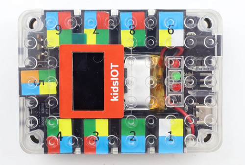
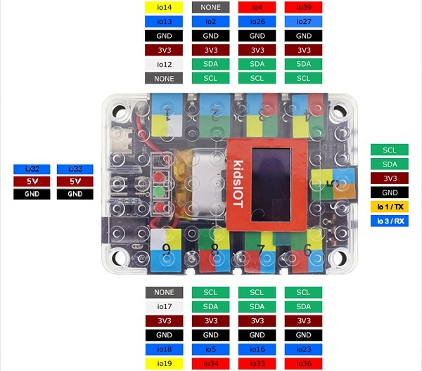
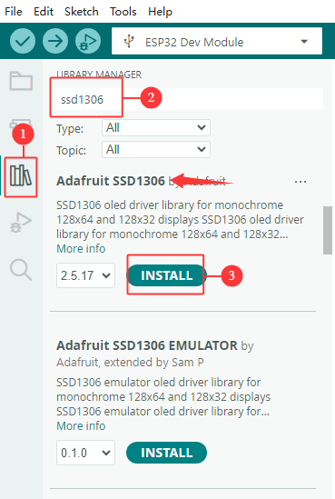
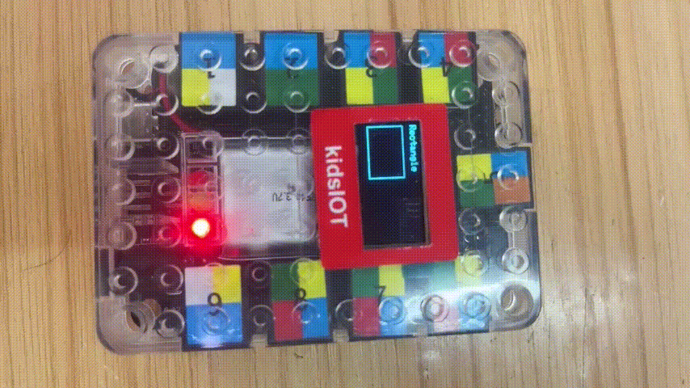
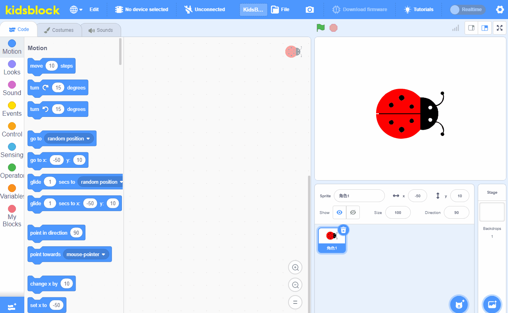
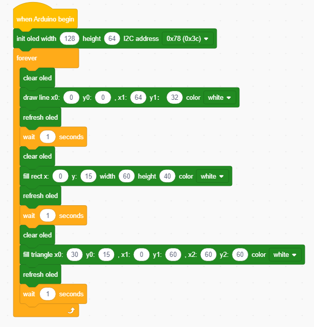

# KD2132 Kidsbits ESP32 V2 STEM Electronic Building Block Programming Main Controller



## What is KidsIOT

KidsIOT Educational Development Board is a teaching tool designed for students and beginners, aiming to cultivate their interest and skills in Science, Technology, Engineering and Mathematics (STEM).

Equipped with an ESP32 chip, it delivers a complete solution for a wide range of IoT applications. In addition, its Wi‑Fi and Bluetooth/BLE functions are fully compatible with the Arduino IDE. It features 21 digital input/output pins (16 of which can be used as PWM outputs), 4 analog inputs, 7 sets of I2C interfaces, 2 servo pin interfaces, and a 128×64 OLED display. A 1000 mAh lithium battery is built in, along with a battery voltage and current detection circuit to monitor the board’s battery level and current in real time.

1. **Beginner-friendly**: Boasting a simple and user-friendly design, it allows STEM beginners to get started quickly. It provides abundant learning resources, tutorials and projects to help students master programming and electronic principles step by step.
2. **Features**: The on-board 128×64 OLED screen facilitates experiments and project development. It supports KidsBlock graphical programming for more intuitive and engaging coding. Its expansion interfaces support connection to additional modules and sensors, expanding students’ creativity and project possibilities.
3. **Educational use**: Suitable for school STEM courses, it helps students learn programming, electronics and engineering concepts. It encourages hands-on projects and experiments to build students’ problem-solving skills and innovative thinking.
4. **Cross-platform support**: Compatible with multiple programming languages and development environments, including Arduino IDE, KidsBlock and Python.


## KidsIOT Parameters

|           MCU           | ESP32-WROOM-32E                                                  |
| :-------------------------: | ------------------------------------------------------------ |
|          Operating voltage          | 3.3V                                                         |
|          Input voltage          |Internal battery power supply DC 3.1-4.2V <br />USB power supply: DC 5V<br />DC power supply: DC 6-12V                                |
|          Output current          |  Battery and USB power supply: 600mA <br />DC power supply: 800mA  |
|          Battery charging/discharging duration          |  Charge at 5V/2A for about 2 hours; Average standby duration: 4 hours  |
|      Digital I/O pins      | 21 (among which 3 are for only input) |
| PWM  Digital I/O | 18                                                           |
|      Analog input pin      | 13                                                           |
|   DC of each I/O   | 20mA                                                         |
|       Flash memory       | 4MB                                                          |
|            SRAM             | 520KB                                                        |
|          Clock rate          | Integrated crystal oscillator (40 MHz)<br />Default frequency 80 MHz, maximum 240 MHz |
|        WIFI protocol        | 802.11 b/g/n (802.11n, speed up to 150 Mbps)    |
|       WIFI frequency       | 2.4 GHz ~ 2.5 GHz                                            |
|     BT protocol      | Suitable for BT V4.2 BR/EDR and BLE protocol. |
| BT radio frequency | NZIF receiver<br />Sensibility -97dBm, Class-1, Class-2 and Class-3 transmitter AFH |
|      Operating temperature      | -5~50 °C                                                |
|          Weight          | 87g                                                          |
|         Dimensions         | 60\*84\*27mm                                                        |

## KidsIOT Pin-out



## What Can KidsIOT Do

KidsIOT can be combined with various sensors and modules to realize multiple applications such as STEM teaching, IoT projects, intelligent control works and DIY creative projects.

1. **Educational Applications**: It supports both graphical programming and text-based coding for students at different learning stages.
2. **Intelligent Control Applications**: Featuring a high-performance main controller and powerful expandability, it makes it easy to build all kinds of intelligent control projects.
3. **DIY Creative Projects**: By combining input and output sensors and modules, a wide variety of DIY creative works can be developed rapidly.

## How to Use KidsIOT

### About Arduino IDE
[**Arduino IDE tutorials for beginners**](https://docs.keyestudio.com/projects/Arduino/en/latest/Arduino%20IDE%20Tutorial.html#b-how-to-install-a-library).

#### On-board OLED
KidsIOT is equipped with a 128x64 pixels OLED. Next we'll introduce how to use it through Arduino.

**Install OLED driver library:** 

Open Arduino IDE and click on **LIBRARY MANAGER**, search "**SSD1306**" and download its library file "**Adafruit_SSD1306**";



**OLED displays icons:**

Here are codes to enable icon display on the OLED.



```c
#include <Wire.h>
#include <Adafruit_GFX.h>
#include <Adafruit_SSD1306.h>

// OLED screen resolution
#define SCREEN_WIDTH 128
#define SCREEN_HEIGHT 64
#define OLED_RESET -1        // No reset pin used
#define SCREEN_ADDR 0x3C      // I2C address of OLED module
Adafruit_SSD1306 display(SCREEN_WIDTH, SCREEN_HEIGHT, &Wire, OLED_RESET);

int imgIdx = 0;   // Index for current graphic, renamed to avoid conflict with system index()
// Name list for each shape
const char *nameList[] = {
  "Rectangle",
  "Filled Rect",
  "Round Rect",
  "Filled Round",
  "Circle",
  "Filled Circle",
  "Triangle",
  "Filled Tri"
};

// Draw shape according to index
void drawByIndex(int idx)
{
  switch(idx)
  {
    case 0:
      display.drawRect(0, 15, 60, 40, SSD1306_WHITE); // Outline rectangle
      break;
    case 1:
      display.fillRect(0, 15, 60, 40, SSD1306_WHITE); // Filled rectangle
      break;
    case 2:
      display.drawRoundRect(0, 15, 60, 40, 8, SSD1306_WHITE); // Outline rounded rectangle, radius=8
      break;
    case 3:
      display.fillRoundRect(0, 15, 60, 40, 8, SSD1306_WHITE); // Filled rounded rectangle, radius=8
      break;
    case 4:
      display.drawCircle(20, 35, 20, SSD1306_WHITE); // Outline circle, center(20,35), radius=20
      break;
    case 5:
      display.fillCircle(20, 35, 20, SSD1306_WHITE); // Filled circle, center(20,35), radius=20
      break;
    case 6:
      display.drawTriangle(30, 15, 0, 60, 60, 60, SSD1306_WHITE); // Outline triangle, 3 vertex points
      break;
    case 7:
      display.fillTriangle(30, 15, 0, 60, 60, 60, SSD1306_WHITE); // Filled triangle, 3 vertex points
      break;
  }
}
void setup()
{
  Serial.begin(115200); // Initialize serial port for debug

  // Initialize OLED, use internal charge pump
  if(!display.begin(SSD1306_SWITCHCAPVCC, SCREEN_ADDR))
  {
    Serial.println(F("OLED init failed"));
    for(;;); // Halt program if OLED cannot be detected
  }
  display.clearDisplay(); // Clear screen buffer
}
void loop()
{
  display.clearDisplay(); // Clear buffer before drawing new frame
  display.setCursor(0,0); // Set text cursor position (x=0,y=0)
  display.setTextSize(1); // Set text scale factor
  display.setTextColor(SSD1306_WHITE); // Set text color to white
  display.println(nameList[imgIdx]); // Print current shape name

  drawByIndex(imgIdx); // Draw selected shape
  display.display();   // Send buffer data to OLED screen

  delay(2000);         // Hold for 2 seconds
  imgIdx++;            // Switch to next shape
  if(imgIdx >= 8) imgIdx = 0; // Reset index when reaching last item, loop again
}
```

### About KidsBlock

[**KidsBlock tutorials for beginners**](https://wiki.kidsbits.cc/projects/KidsBlock/en/latest/).

#### On-board OLED

KidsIOT is equipped with a 128x64 pixels OLED. Next we'll introduce how to use it through KidsBlock.

**OLED displays icons:**

First of all, we need to connect to the KidsIOT properly.



Here are the code blocks to enable icon display on the OLED.



## Troubleshooting
1. **Battery cannot be charged?** 

   A: The charging IC is triggered for protection due to excessively high or low battery temperature. Please charge it after the temperature returns to normal.

2. **Failed to flash programs via USB?** 

   A: Use the original USB cable supplied with this product or replace it with another USB cable that supports data transfer.

3. **The board cannot power on without an external power supply?** 

   A: The battery voltage is too low to boot the device.